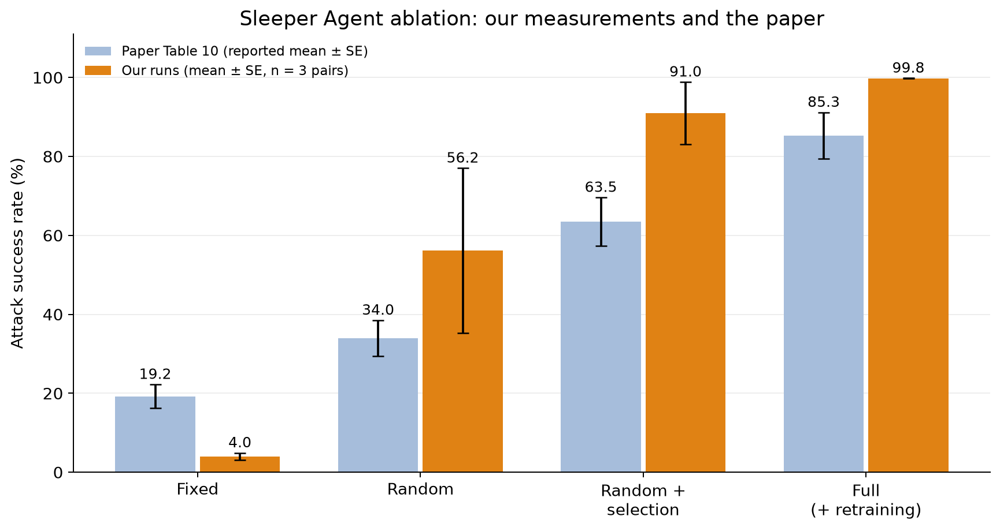
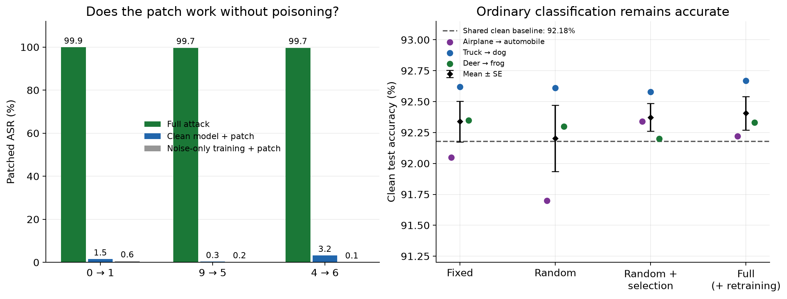
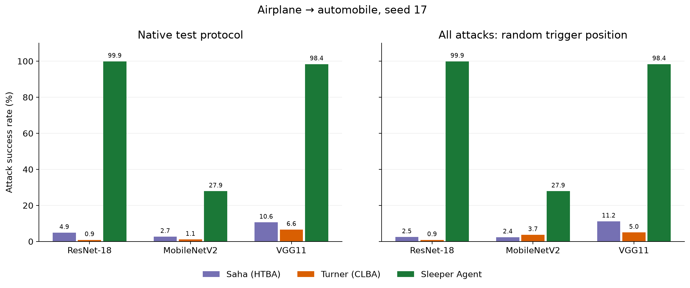

# Sleeper Agent: Clean-Label Backdoors on CIFAR-10

**Sleeper Agent teaches a hidden mistake through correctly labeled training images.** My implementation produced high attack success across three ResNet-18 class pairs, while a separate architecture comparison showed much lower success on MobileNetV2.

ECE 491E reproduction of Souri et al., *Sleeper Agent: Scalable Hidden Trigger Backdoors for Neural Networks Trained from Scratch*. [Paper](https://arxiv.org/abs/2106.08970) · [reference implementation](https://github.com/hsouri/Sleeper-Agent).

### The attack in one minute

**The attacker changes the training pictures, while the victim follows ordinary training.** The attacker edits 500 correctly labeled images, or 1% of CIFAR-10. For Sleeper Agent, the visible trigger never appears in the victim's training data. The labels stay correct, and the model starts with fresh random weights.

After training, adding the trigger to an image from a chosen source class is intended to make the model predict the target class. For example, an airplane should still be recognized without the trigger, but be called an automobile when the trigger is present. The aim is a specific hidden error, while ordinary predictions remain largely accurate.

The poison is made in five steps:

1. Train a clean practice model, called a surrogate.
2. Choose target-class training images to change.
3. Adjust their pixels within a small allowed bound.
4. Refresh the surrogate during crafting in the full attack.
5. Train a fresh victim on the poisoned dataset and test it.

Gradient matching means choosing pixel changes so learning from the poisoned images pushes the model's weights in a similar direction to learning the attacker's desired mistake. The practice model guides those changes; the final victim must learn the hidden behavior from the resulting dataset.

### What I tested

**I tested crafting choices in a three-pair ResNet-18 ablation, with clean and random-noise controls.** I then compared ResNet-18, MobileNetV2, and VGG11 against Hidden-Trigger Backdoor (HTBA) and Clean-Label Backdoor (CLBA), using one source/target pair and one seed.

## Setup

**The reported training ran on one NVIDIA GeForce RTX 5070 Ti Laptop GPU.** The training setup requires Python 3.12, `uv`, and NVIDIA CUDA 12.8 support. Run commands from the repository root.

Windows:

```powershell
uv venv --python 3.12 .venv
uv pip install --python .venv/Scripts/python.exe -r requirements-lock.txt
.venv/Scripts/python.exe scripts/download_data.py
```

Linux with CUDA:

```bash
uv venv --python 3.12 .venv
uv pip install --python .venv/bin/python -r requirements-lock.txt
.venv/bin/python scripts/download_data.py
```

macOS, for CPU report generation rather than the CUDA training configs:

```bash
uv venv --python 3.12 .venv
uv pip install --python .venv/bin/python numpy scipy matplotlib
.venv/bin/python scripts/download_data.py
```

The Windows environment was tested on the experiment machine. The macOS commands install the packages needed by the README builder; they do not reproduce GPU training. The downloader fetches the official CIFAR-10 archive and checks its checksum.

An 80-epoch ResNet-18 victim took about 38 minutes. A full attack also needs poison crafting and surrogate training. The architecture comparison finished in about 14.6 hours of active runner time, including CPU work and checkpoint writes, with one result reused. Tests can be run with `.venv/Scripts/python.exe -m pytest -q`; on Linux, use `.venv/bin/python`. The full experiment test suite expects the training environment; the macOS commands above cover report generation only.

## Run

**Training, re-scoring, and rebuilding the write-up are separate commands.** The table uses Windows paths; Linux/macOS report commands use `.venv/bin/python` instead.

| Command | What it does | Output location |
|---|---|---|
| `.venv/Scripts/python.exe -u scripts/run_study.py` | Train the three-pair ablation | `results/main_study/`, `reports/main_study/` |
| `.venv/Scripts/python.exe scripts/table6_preflight.py` then `.venv/Scripts/python.exe scripts/run_table6.py --log-file results/table6/run.log` | Check settings and run the architecture comparison | `results/table6/`, `reports/table6/` |
| `.venv/Scripts/python.exe scripts/rescore_table6.py` | Re-score saved victims; no training | `reports/table6/rescored.json`, `table6.md` |
| `.venv/Scripts/python.exe -m analysis.build_readme --readme-only` | Rebuild this README; `--table6-only` also rebuilds the comparison figure | `README.md`, optionally `reports/table6/figures/` |

The runners skip completed trials and resume from checkpoints; the architecture comparison updates [progress.md](progress.md). Re-scoring requires the local saved victims, including the reused original ResNet-18 checkpoint, because `results/` and `data/` are not tracked by Git.

The preflight checks the tests, small pipeline runs, and measured timing before allowing the long comparison. For presenting these completed experiments, the saved reports are sufficient. Rebuilding the README does not require training or loading victim weights.

## Results

**The results separate whether the poison works from how consistently it works.** Attack success rate (ASR) is the percentage of all 1,000 held-out source-class test images classified as the chosen target after adding the trigger. Clean accuracy is the percentage correct across all 10,000 unmodified test images. All scores below use held-out data; test images were not used to craft poisons.

### 4.1 Each ingredient helps

**Mean attack success increased as random placement, image selection, and retraining were added.** This ablation follows four configurations from the paper's Table 10. Every configuration used the same three source/target pairs, and every victim was evaluated with random trigger positions. Here, “fixed patch” refers to placement during crafting, not placement during the test.



| Configuration | Paper ASR (± as reported) | Our ASR ± SE | Clean acc. |
|---|---:|---:|---:|
| Fixed patch | 19.25 ± 3.01% | 4.00 ± 0.93% | 92.34% |
| Random patch | 33.95 ± 4.57% | 56.17 ± 20.88% | 92.20% |
| Random + selection | 63.49 ± 6.13% | 90.97 ± 7.89% | 92.37% |
| Full attack | 85.27 ± 5.90% | 99.77 ± 0.07% | 92.41% |

Our ± values are one standard error across three pair/seed trials. The paper's ± values are copied as reported; their uncertainty type is not specified. The archived figure labels the paper's error bars as SE, so that part of its legend should be read as “± as reported.”

Our fixed-patch ASR is lower than the paper's, 4.0% versus 19.25%, while the other three are higher, including 99.77% versus 85.27% for the full attack; with only three pairs and a different pair set, we cannot attribute that gap to a cause.

The random-patch configuration ranged from 34.0% to 97.9% across pairs. That spread is a reason to keep the sample size visible. Selection chooses images that strongly affect the practice model's training gradients, and retraining refreshes that model as the poisons change. The ordering supports their contribution in these tested cases, but the smaller gaps are not statistically settled. The per-pair results are in the Appendix.

### 4.2 The effect comes from the poison

**The optimized poisons produced much higher attack success than the clean and noise controls.** A clean model with the trigger tests whether the patch alone causes the chosen mistake. Random-noise controls test whether arbitrary bounded pixel changes are enough, using either randomly chosen or gradient-selected images.



| Source → target | Clean model + patch | Random-noise control | Selected-noise control | Full attack |
|---|---:|---:|---:|---:|
| Airplane → automobile | 1.5% | 2.3% | 0.6% | 99.9% |
| Truck → dog | 0.3% | 0.1% | 0.2% | 99.7% |
| Deer → frog | 3.2% | 0.6% | 0.1% | 99.7% |

The clean-model scores stayed low, and neither noise control approached the full attack in any tested pair. These comparisons support a poisoning-induced effect. They also show why producing a suitable poison is the central step: adding noise within the same budget did not reproduce the optimized changes' behavior.

Mean clean accuracy for the full attack was 92.41%, compared with 92.18% for the shared clean baseline. Ordinary classification therefore remained close to the control even when the triggered error was frequent. These controls belong to the three-pair ResNet-18 study. They were not repeated for every architecture-comparison cell, so the same level of control evidence should not be assumed for those cells.

### 4.3 Comparison with other attacks: paper Table 6

**Sleeper Agent performed strongly on ResNet-18 and VGG11, but much less strongly on MobileNetV2.** This experiment mirrors the paper's Table 6 comparison: HTBA, CLBA, and Sleeper Agent on the same three architectures. The shared budget is 1% of training images with pixel changes bounded by 16/255.

*one pair (airplane->automobile), one seed; not a statistical reproduction*

Our pair was airplane → automobile, seed `17`. Each cell crafted against the same architecture as its fresh victim; this does not test transfer between different architectures. The paper's columns average multiple trials, so its values are reference points rather than matched repetitions of our experiment.



Each cell below shows **ours / paper**. Our HTBA uses its fixed inset position, `(19,19)`, and CLBA uses the bottom-right corner, `(24,24)`. Sleeper Agent uses random positions in its main row. The additional fixed row uses the same saved Sleeper Agent victims; the paper has no corresponding row here.

| Attack | ResNet-18: ours / paper | MobileNetV2: ours / paper | VGG11: ours / paper | Average: ours / paper |
|---|---:|---:|---:|---:|
| Saha (HTBA) | 4.90% / 3.50% | 2.70% / 3.76% | 10.60% / 5.02% | 6.07% / 4.09% |
| Turner (CLBA) | 0.90% / 2.78% | 1.10% / 3.50% | 6.60% / 4.70% | 2.87% / 3.66% |
| Sleeper Agent | 99.90% / 78.84% | 27.90% / 75.96% | 98.40% / 86.60% | 75.40% / 80.47% |
| Sleeper Agent, trigger fixed at (24,24) | 96.50% / — | 4.00% / — | 39.10% / — | 46.53% / — |

MobileNetV2's 27.90% is far below the paper's 75.96%. ResNet-18 and VGG11 are above the paper's values. One pair and one seed cannot explain why. The average across architectures also hides that uneven behavior, so it should not be used alone to describe the result.

Trigger position mattered a lot in this trial: fixed placement gave 96.50% on ResNet-18, 4.00% on MobileNetV2, 39.10% on VGG11. Those scores came from re-scoring the same victims, not from making new poisons. All nine random re-scores and clean accuracies matched the original saved results, which checks that changing the evaluation was isolated from training.

The ResNet-18 Sleeper Agent cell reuses the airplane → automobile full-attack victim from the ablation. It is not a separate run. CLBA used a clean surrogate instead of the benchmark's adversarially trained surrogate, and HTBA uses corrected greedy matching. Those differences limit an exact paper comparison. The all-random table, clean-accuracy table, and implementation notes are in the Appendix.

### 4.4 Limitations

**The evidence is limited by trial count and differences in the comparison setup.**

- The ablation has three pair/seed trials per configuration; the architecture comparison has one.
- CLBA's surrogate, HTBA's matching, and trigger choices differ from the reference setup.
- The reused ResNet-18 cell is shared evidence, not another independent trial.
- Position re-scoring tests existing victims; it does not test new poisons or seeds.
- ImageNet, defenses, cross-architecture transfer, and parameter sweeps were not tested.

### 4.5 Takeaway

**The implementation reproduced a strong hidden backdoor on the tested ResNet-18 pairs while preserving normal classification.** The architecture comparison was mixed, and its MobileNetV2 result remains an unresolved limitation. The next useful extension would repeat pairs and seeds while matching the baseline choices more closely.

## Appendix

**The supporting details below explain the implementation and retain the full recorded evidence.**

<details>
<summary>Poison examples and integrity checks</summary>

**The visible training changes and the test trigger serve different roles.**


The first two columns show the same target-class training image before and after poisoning, with its label unchanged. The difference is amplified in the third column. The final two columns show a held-out source image and the victim's predictions before and after adding the trigger. One clean-correct, trigger-flipped example was selected per pair for illustration; reported scores use the full source test set.

**Main-study checks:** exactly 500 target-class images changed; labels stayed unchanged; pixels remained valid; changes stayed within `16/255`; and the exact trigger was absent from the victim's training dataset.

**Architecture-comparison CLBA exception:** CLBA intentionally stamps a training trigger, then clips the final changes to the bound. Its checks allow that stamped pattern and verify the perturbation bound both before and after stamping. This exception does not apply to Sleeper Agent or HTBA.

</details>

<details>
<summary>Gradient alignment</summary>

**Alignment measures the crafting objective, not final attack success.**


The left plot tracks the full poison gradient during crafting; dotted lines mark the four surrogate refreshes. The right plot uses a 16-example subset during victim training on airplane → automobile, rather than the 500-image crafting objective. Their scales are therefore different. The two-pass derivative is checked against direct differentiation and finite differences; held-out ASR and controls supply the behavioral evidence.

</details>

<details>
<summary>Core objective and settings</summary>

**The implementation optimizes a gradient-matching objective with bounded pixel changes.**

The following is an explanatory excerpt. The implementation is in [src/craft.py](src/craft.py).

```python
params = tuple(surrogate.parameters())
grad_adv = torch.autograd.grad(
    cross_entropy(surrogate(patched_source_train), target_labels), params
)
a = torch.cat([g.reshape(-1) for g in grad_adv]).detach()

grad_train = torch.autograd.grad(
    cross_entropy(surrogate(augment(clean + delta)), true_labels),
    params, create_graph=True,
)
g = torch.cat([v.reshape(-1) for v in grad_train])
alignment_loss = 1 - cosine_similarity(g[None], a[None])[0]

for step in range(250):
    cosine, grad = alignment_step(...)
    signed_adam_step(optimizer, delta, grad, units="normalized")
    project(delta, clean, epsilon=16 / 255)
    if step + 1 in (50, 100, 150, 200):
        surrogate = train_fresh_surrogate(current_poisoned_data, epochs=40)
        a = recompute_adversarial_gradient(surrogate).detach()
```

The two-pass derivative avoids keeping second-derivative graphs for all 500 images in memory at once. Tests compare it with direct differentiation and finite differences. Crop/flip augmentation is differentiable, and BatchNorm statistics are frozen during crafting.

| Setting | Value |
|---|---|
| Dataset | Full CIFAR-10 |
| Poison budget / bound | 500 target-class images / 16/255 in pixel space |
| Trigger / source-gradient pool | Seeded Bernoulli RGB 8×8 patch / 512 source training images |
| Training | SGD, Nesterov 0.9, weight decay 4e-4, batch 128 |
| Initial learning rate | ResNet-18: 0.1; MobileNetV2 and VGG11: 0.01 |
| Epochs | 40 initial surrogate, 40 per refresh, 80 per victim/control |
| Learning-rate drops | Factor 0.1 at epochs 14, 24, 35 |
| Sleeper crafting | 250 signed-Adam steps, normalized-coordinate LR 0.025 |
| Crafting LR drops | Factor 0.1 at steps 93, 156, 218 |
| Surrogate refreshes | None in the reduced configurations; four fresh initializations in the full attack |
| Precision | Mixed precision for training; FP32 for crafting and evaluation |

Configs: [ResNet ablation](configs/cifar10_full.yaml), [ResNet comparison](configs/table6_resnet18.yaml), [MobileNetV2](configs/table6_mobilenetv2.yaml), [VGG11](configs/table6_vgg11.yaml).

</details>

<details>
<summary>Baseline implementation differences</summary>

**This is a comparison modeled on the paper, with documented adaptations.**

- CLBA uses a shared clean surrogate. The public benchmark's default points to an adversarially trained checkpoint.
- HTBA enforces a one-to-one greedy feature assignment. The reference loop can reuse rows or columns; the correction is recorded explicitly.
- Every comparison cell uses the same seeded Bernoulli trigger. The paper's primary experiments use a reference trigger pattern.
- CLBA stamps its trigger and projects the final image back into the perturbation bound. The training pattern is therefore clipped.
- Main-row test placement is method-specific. Re-scoring also reports every attack with random placement, using seed `717`.

Algorithms, schedules, source links, and differences are documented in [table6_baselines.md](docs/table6_baselines.md). Published comparison values are stored separately as [paper_reference.json](reports/table6/paper_reference.json), sourced from the [paper's Table 6](https://arxiv.org/html/2106.08970v3#S4.T6); they are not project measurements.

</details>

<details>
<summary>Per-pair scores and additional comparison tables</summary>

**The detailed tables show variation that averages can hide.**

Ablation pairs and seeds:


| Source → target | Seed | Fixed | Random | Random + selection | Full |
|---|---:|---:|---:|---:|---:|
| Airplane → automobile | `17` | 2.7% | 36.6% | 98.2% | 99.9% |
| Truck → dog | `368152593` | 5.8% | 34.0% | 75.2% | 99.7% |
| Deer → frog | `1231470895` | 3.5% | 97.9% | 99.5% | 99.7% |

All attacks, random trigger position:

| Attack | ResNet-18 | MobileNetV2 | VGG11 | Average |
|---|---:|---:|---:|---:|
| Saha (HTBA) | 2.50% | 2.40% | 11.20% | 5.37% |
| Turner (CLBA) | 0.90% | 3.70% | 5.00% | 3.20% |
| Sleeper Agent | 99.90% | 27.90% | 98.40% | 75.40% |

Clean accuracy for the architecture-comparison victims, unchanged by trigger-placement re-scoring:

| Attack | ResNet-18 | MobileNetV2 | VGG11 | Average |
|---|---:|---:|---:|---:|
| Saha (HTBA) | 92.51% | 88.80% | 89.37% | 90.23% |
| Turner (CLBA) | 92.36% | 88.79% | 88.96% | 90.04% |
| Sleeper Agent | 92.22% | 88.54% | 88.99% | 89.92% |

The re-scoring script reported 24.8 seconds of evaluation-only runtime. Original cell results and the historical random-position summary were preserved.

</details>

<details>
<summary>Repository layout and source data</summary>

**The README is generated from the template and saved reports.**

```text
src/                          data, models, crafting, training and evaluation
scripts/run_study.py           three-pair ResNet-18 ablation
scripts/run_table6.py          architecture comparison
scripts/rescore_table6.py      fixed/random evaluation of saved victims
analysis/build_readme.py       report data → README and figures
analysis/README.template.md    presentation wording and structure
configs/                      training recipes and study pairs
reports/main_study/            ablation measurements and original figures
reports/table6/                comparison, re-scoring and paper reference data
tests/                        correctness checks
results/, data/               local artifacts, excluded from Git
```

Ablation sources: [measurements](reports/main_study/measurements.json), [summary](reports/main_study/summary.json), [controls](reports/main_study/controls.json), and [presentation data](reports/main_study/presentation_data.json). Architecture comparison: [re-scored results](reports/table6/rescored.json), [comparison report](reports/table6/table6.md), [original random summary](reports/table6/summary.json), and [preflight measurements](reports/table6/preflight.md).

The [original eight-pair proposal](docs/original_study_plan.md) is retained as planning history; it does not describe the final experiment count. The clean control is a separate 80-epoch model. The initial surrogate and clean control were each reused across the ablation pairs. There were no extra random-noise controls for the architecture comparison.

</details>
