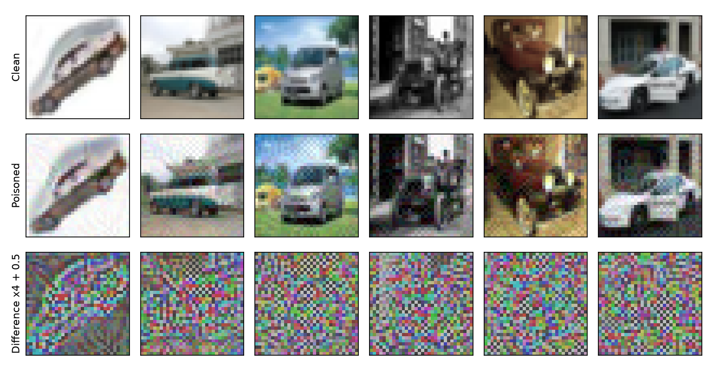
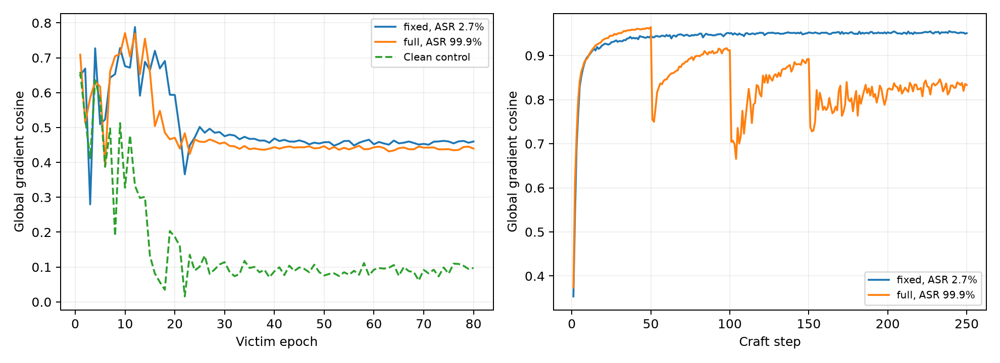

# Sleeper Agent: an independent CIFAR-10 reproduction

We study whether tiny, correctly labeled changes to 1% of training images can teach a classifier a hidden response to a patch. The classifier should recognize ordinary images normally, while patched source-class images are predicted as a chosen target class. This repository implements the attack from scratch, following [Souri et al., NeurIPS 2022](https://arxiv.org/abs/2106.08970).

## Results and current evidence

<!-- RESULTS_START -->

**Time-limited pilot: 4/4 scheduled configurations completed.** This uses one source/target pair (0 → 1), seed 17, with the original full CIFAR-10 training recipe and saved checkpoints. The original 40-experiment sweep is archived.

| Configuration | Paper ASR (reference) | Pilot ASR | Clean accuracy | Noise-control ASR | Status |
|---|---:|---:|---:|---:|---|
| Fixed patch location | 19.25% | 2.70% | 92.05% | 2.30% | Complete |
| Random patch location | 33.95% | 36.60% | 91.70% | 2.30% | Complete |
| Random patch + retraining | 59.42% | — | — | — | Outside four-hour scope |
| Random patch + selection | 63.49% | 98.20% | 92.34% | 0.60% | Complete |
| Full attack: random patch + retraining + selection | 85.27% | 99.90% | 92.22% | 0.60% | Complete |

**There is one trial per configuration. Standard errors and confidence intervals are unavailable.** The paper averages multiple class pairs; its reference values cannot be compared as equivalent estimates. This pilot illustrates behavior on one pair and does not establish population-level effect sizes.





Alignment is a diagnostic measured on small training subsets. The clean curve uses fixed target examples and poisoned curves use selected poisons, so their gap is not a comparison of identical examples.

The clean control achieved 92.18% ordinary accuracy and 1.50% patched ASR. Every completed trial passed the pixel-space budget, unchanged-label, target-only selection, exact poison-count, and trigger-absence checks.

**What the completed measurements show.** On this pair, the full attack reached 99.90% ASR with 92.22% clean accuracy; its matched noise-only control reached 0.60% ASR. Random placement changed ASR by +33.90 percentage points on this pair. Selection changed ASR by +61.60 percentage points on this pair. Retraining with selection enabled changed ASR by +1.70 percentage points on this pair. These are single-pair observations; the small sample does not establish how the effects vary across other source/target pairs.

**Implementation lesson.** The observed interruption was a Windows lock on a progress file. Bounded retries and isolating display failures allowed checkpoint-based recovery. The two-pass global-gradient calculation avoided retaining all poison activation graphs, and direct-gradient, finite-difference, and recovery tests checked its behavior.

The four-hour budget reserves 15 minutes for analysis and writing. The standalone retraining-only arm and seven additional class pairs are outside this scope. Any phase unfinished at the deadline remains checkpointed and is marked incomplete. The budget covers the remaining work: the full attack and parts of the fixed arm were computed before this window and are reused.

**Verification:** 28 tests passed, including global-gradient and finite-difference checks, CUDA double-backward, checkpoint recovery, Windows file locks, deadline enforcement, and single-pair reporting.

<!-- RESULTS_END -->

## What was built

The pipeline trains a clean surrogate, selects only target-class training images, crafts bounded pixel perturbations, and trains an independently initialized victim. The trigger is never written into victim training data. Its only uses are source-gradient estimation during crafting and held-out evaluation.

The selected configurations share the source/target pair, seeds, training orders, and evaluation patch positions. The clean-label constraint, exact number of changed images, pixel range, perturbation bound, and absence of the exact trigger pattern are checked before victim training. Clean and random-noise controls are included. The active four-hour pilot evaluates four configurations on one pair; the original five-arm, eight-pair design is archived.

## Two diagnostic figures

Each completed trial writes `poison_grid.png`: clean images, their poisoned counterparts, and a magnified difference. The analysis command writes `alignment.png`, showing global gradient alignment during crafting and victim training. These figures are generated from actual measurements; no illustrative result curves are substituted.

## Core code

The objective is one cosine over the concatenation of **all** parameter gradients:

```python
grad_train = torch.autograd.grad(
    cross_entropy(model(clean + delta), target_labels),
    tuple(model.parameters()), create_graph=True,
)
g = torch.cat([v.reshape(-1) for v in grad_train])
a = adversarial_gradient.detach()
loss = 1 - cosine_similarity(g[None], a[None])[0]
delta_gradient = torch.autograd.grad(loss, delta)[0]

for step in range(craft_steps):
    # Production code computes this exact derivative in two memory-bounded passes.
    cosine, delta_gradient = alignment_step(...)
    delta.grad = delta_gradient.sign()
    adam.step()
    project(delta, clean, epsilon)  # raw pixels, before normalization
    if step + 1 in retraining_events:
        surrogate = train_fresh_model(clean_training_data_with_delta)
        adversarial_gradient = recompute_source_gradient(surrogate).detach()
```

The executable implementation is [src/craft.py](src/craft.py). Standard training and evaluation are in [src/victim.py](src/victim.py).

## Implementation choices and empirical questions

**Memory.** Retaining double-backward graphs for 500 images can exceed laptop memory. Simply summing minibatch gradients with `create_graph=True` retains all those graphs. We instead compute the global training gradient without retaining graphs, differentiate the cosine analytically with respect to that gradient, then replay the exact same augmentations one minibatch at a time. A direct double-backward reference and directional finite differences verify this derivative. BatchNorm uses frozen running statistics during crafting, and standard training behavior during training.

**Differentiable augmentation.** Crop and flip use tensor indexing. The commonly suggested `grid_sample` does not generally supply the second derivative required here; index operations preserve the path to the perturbations.

**Reference checks, limited to the two omissions allowed by the plan.** In the [reference optimizer setup](https://github.com/hsouri/Sleeper-Agent/blob/master/forest/witchcoven/witch_base.py), the effective Adam rate is `tau * pbatch / 512`, with default `tau=0.1`; milestones are `R // 2.667`, `R // 1.6`, and `R // 1.142`, with factor 0.1. We choose normalized-coordinate LR **0.025** for the full experiment (nominal pbatch 128), independent of the memory minibatch size. Each Adam update is multiplied by its channel standard deviation to recover the equivalent pixel-space update; delta and all projection constraints remain in raw pixels. A test compares this against running Adam directly on normalized perturbations. The smoke configuration uses pixel-coordinate LR 0.1. The same reference file and [options](https://github.com/hsouri/Sleeper-Agent/blob/master/forest/options.py) confirm fresh initialization for the default retraining scenario. No reference attack code is imported or wrapped.

**Other choices.** K=512 training-source examples estimate the detached adversarial gradient, which refreshes only after surrogate weights change. Evaluation patch positions are random in every arm, including fixed-location crafting. ASR uses **all held-out source images**; ASR conditional on correct clean classification is recorded separately. Alignment telemetry during victim training uses a fixed 16-image training subset in full runs to limit overhead, whereas crafting uses the complete poison set. The training LR milestones remain 14, 24, 35 even for the 80-epoch victim, following the supplied plan.

**Variance.** The pilot has one paired trial per configuration, so standard errors and confidence intervals across class pairs are unavailable. Differences describe this one pair. The original eight-pair design is preserved for future work; its analysis code supports Student-t intervals when repeated paired trials are available. The present results do not resolve variation across class pairs.

**More compute.** Additional paired class pairs would give stronger evidence about variance and effect sizes before expanding to retraining-factor or epsilon sweeps.

## Scope

This is a time-limited pilot of Table 10 on CIFAR-10. The standalone retraining-only arm, additional class pairs, ImageNet, transfer between architectures, defenses, and epsilon/retraining-factor sweeps are outside this submission's measurements. A successful attack on one pair does not establish numerical reproduction of the paper's averages.

## Reproduction

Run `.venv/Scripts/python.exe -u scripts/run_all.py` to run or resume the pilot. See [SETUP.md](SETUP.md) for environment setup and checkpoints, [the four-hour plan](docs/OVERNIGHT_PLAN.md) for the schedule, and [the original specification](docs/archive/SLEEPER_AGENT_PLAN.md) for the archived full study. Exact configurations and measurements are exported under `reports/four_hour/`; local model checkpoints remain under `results/`.
