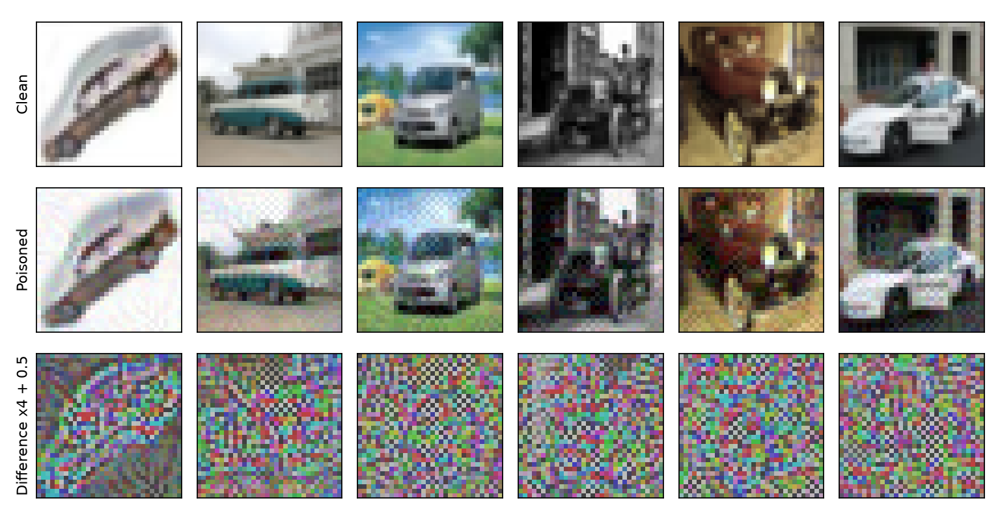
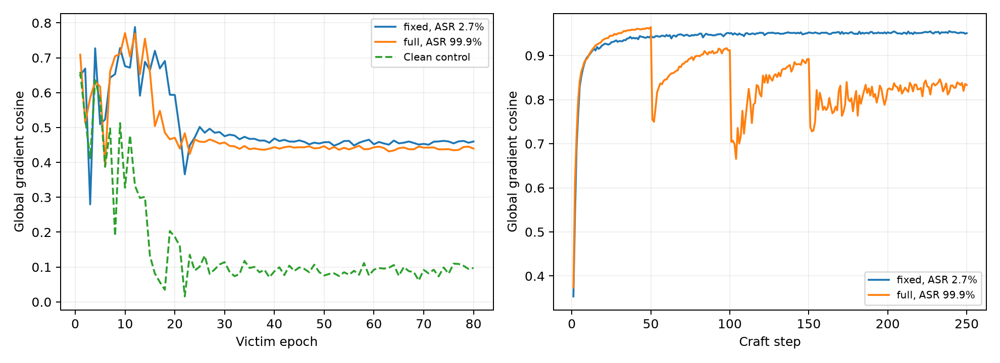

# Four-hour pilot report

**Time-limited pilot: 2/4 scheduled configurations completed.** This uses one source/target pair (0 → 1), seed 17, with the original full CIFAR-10 training recipe and saved checkpoints. The original 40-experiment sweep is archived.

| Configuration | Paper ASR (reference) | Pilot ASR | Clean accuracy | Noise-control ASR | Status |
|---|---:|---:|---:|---:|---|
| Fixed patch location | 19.25% | 2.70% | 92.05% | 2.30% | Complete |
| Random patch location | 33.95% | — | — | — | Pending / incomplete |
| Random patch + retraining | 59.42% | — | — | — | Outside four-hour scope |
| Random patch + selection | 63.49% | — | — | — | Pending / incomplete |
| Full attack: random patch + retraining + selection | 85.27% | 99.90% | 92.22% | 0.60% | Complete |

**There is one trial per configuration. Standard errors and confidence intervals are unavailable.** The paper averages multiple class pairs; its reference values cannot be compared as equivalent estimates. This pilot illustrates behavior on one pair and does not establish population-level effect sizes.

Alignment is a diagnostic measured on small training subsets. The clean curve uses fixed target examples and poisoned curves use selected poisons, so their gap is not a comparison of identical examples.

The clean control achieved 92.18% ordinary accuracy and 1.50% patched ASR. Every completed trial passed the pixel-space budget, unchanged-label, target-only selection, exact poison-count, and trigger-absence checks.

**What the completed measurements show.** On this pair, the full attack reached 99.90% ASR with 92.22% clean accuracy; its matched noise-only control reached 0.60% ASR. These are single-pair observations; the small sample does not establish how the effects vary across other source/target pairs.

**Implementation lesson.** The observed interruption was a Windows lock on a progress file. Bounded retries and isolating display failures allowed checkpoint-based recovery. The two-pass global-gradient calculation avoided retaining all poison activation graphs, and direct-gradient, finite-difference, and recovery tests checked its behavior.

The four-hour budget reserves 15 minutes for analysis and writing. The standalone retraining-only arm and seven additional class pairs are outside this scope. Any phase unfinished at the deadline remains checkpointed and is marked incomplete. The budget covers the remaining work: the full attack and parts of the fixed arm were computed before this window and are reused.

**Verification:** 28 tests passed, including global-gradient and finite-difference checks, CUDA double-backward, checkpoint recovery, Windows file locks, deadline enforcement, and single-pair reporting.

## Measured single-pair differences

## Scope and reproduction

Run or resume with `.venv/Scripts/python.exe -u scripts/run_all.py`. The scheduling plan is `configs/four_hour_run.yaml`; scientific settings remain in `configs/cifar10_full.yaml`. Exact configs, seeds, metrics, and histories are in `measurements.json`. The clean, failed-run, smoke, and original sweep artifacts are preserved.
