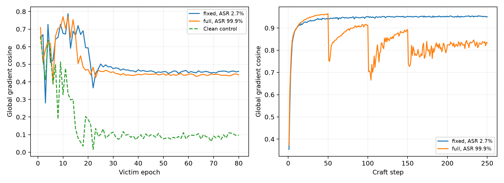

# Overnight multi-pair ablation

Clean baseline patched ASR on original pair: **1.50% (15/1,000)**. New pairs reuse the same clean baseline/surrogate weights, with newly evaluated pair-specific clean controls.

| Configuration | Paper ASR ± SE | Measured ASR ± SE | n | Clean accuracy |
|---|---:|---:|---:|---:|
| fixed | 19.25 ± 3.01% | 4.00 ± 0.93% | 3 | 92.34% |
| random | 33.95 ± 4.57% | 56.17 ± 20.88% | 3 | 92.20% |
| retrain | 59.42 ± 5.78% | pending | 0 | pending |
| select | 63.49 ± 6.13% | 90.97 ± 7.89% | 3 | 92.37% |
| full | 85.27 ± 5.90% | 99.77 ± 0.07% | 3 | 92.41% |

**Unequal n:** each row reports its own completed pair count; arms with different n cover different pair sets. Only matched pairs enter each difference below. One pair has no across-pair error bar.

- random minus fixed: +52.17 pp; matched n=3; 95% CI=[-38.96643525106311, 143.29977252327006].
- select minus random: +34.80 pp; matched n=3; 95% CI=[-40.98533419030911, 110.585340134879].
- full minus random: +43.60 pp; matched n=3; 95% CI=[-46.374838821383655, 133.57484467058612].
- full minus select: +8.80 pp; matched n=3; 95% CI=[-25.027171568361467, 42.627171472994036].

## Control status

- Clean baseline, pair 0→1, seed 17: patched ASR **1.50%**, clean accuracy 92.18%.
- Clean baseline, pair 9→5, seed 368152593: patched ASR **0.30%**, clean accuracy 92.18%.
- Clean baseline, pair 4→6, seed 1231470895: patched ASR **3.20%**, clean accuracy 92.18%.
- Pair A, gradient noise control: ASR 0.20%.
- Pair A, random noise control: ASR 0.10%.
- Pair B, gradient noise control: ASR 0.10%.
- Pair B, random noise control: ASR 0.60%.

## Queue outcomes

- 1: pair A, full, attack: complete.
- 2: pair B, full, attack: complete.
- 3: pair A, fixed, attack: complete.
- 4: pair A, random, attack: complete.
- 5: pair A, select, attack: complete.
- 6: pair B, fixed, attack: complete.
- 7: pair B, random, attack: complete.
- 8: pair B, select, attack: complete.
- 9: pair A, full, noise: complete.
- 10: pair A, fixed, noise: complete.
- 11: pair B, full, noise: complete.
- 12: pair B, fixed, noise: complete.

Completed artifacts from the earlier pilot are preserved. No reduced-fidelity runs were added. The 28-test pilot verification is preserved; overnight changes have separate validation.
