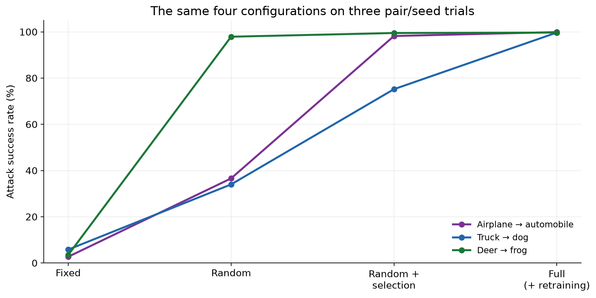
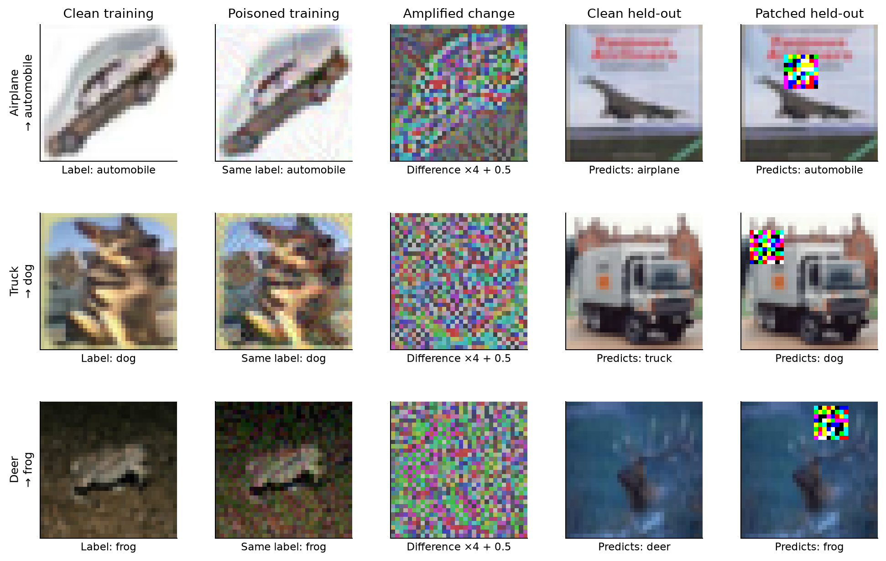
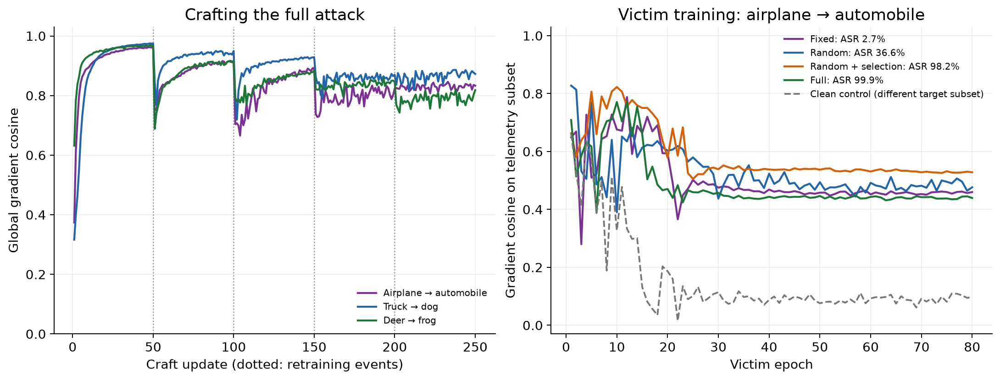

# Sleeper Agent: Clean-Label Backdoors on CIFAR-10

From-scratch reproduction of Souri et al., *Sleeper Agent: Scalable Hidden Trigger Backdoors for Neural Networks Trained from Scratch* (NeurIPS 2022), for the ECE 491E empiricist role. [Paper](https://arxiv.org/abs/2106.08970) · [reference implementation](https://github.com/hsouri/Sleeper-Agent).

The attack subtly changes **500 correctly labeled training images (1%)**. A victim trained from scratch behaves normally on ordinary images, but an **8×8 sticker** on a source-class test image makes it predict the target class. The sticker is never inserted into the victim's training images.

**Headline:** the full attack reached **99.77% mean attack success rate (ASR)** with **92.41% clean accuracy** across **three source/target pairs** (12 attack trials + all noise controls completed).

## Setup

Requires Python 3.12 and a CUDA 12.8-compatible NVIDIA GPU (tested on an RTX 5070 Ti Laptop, 12 GB VRAM, 32 GB RAM). From the repository root:

```powershell
# 1. Create the environment
uv venv --python 3.12 .venv
uv pip install --python .venv/Scripts/python.exe -r requirements-lock.txt

# 2. Check the GPU is visible
.venv/Scripts/python.exe -c "import torch; print(torch.__version__, torch.cuda.is_available())"

# 3. Download CIFAR-10 (official source, checksum-verified) into data/
.venv/Scripts/python.exe scripts/download_data.py

# 4. Optional: run the correctness tests
.venv/Scripts/python.exe -m pytest -q
```

`requirements-lock.txt` pins the exact tested versions; `requirements.txt` lists direct dependencies. More detail (resuming, logs, progress dashboard) is in [SETUP.md](../../SETUP.md).

## Run

**Quick smoke test** (small model, few classes; checks that everything executes, *not* a measure of attack strength):

```powershell
.venv/Scripts/python.exe -m src.run_ablation --config configs/smoke.yaml
```

**One full-scale attack** (airplane → automobile, seed 17; all four ablation arms):

```powershell
.venv/Scripts/python.exe -m src.run_ablation --config configs/cifar10_full.yaml --pairs 1 --arms fixed random select full
```

Use `--arms full` to run only the complete attack. Arms: `fixed` (fixed patch), `random` (random patch), `select` (+ gradient-norm selection), `full` (+ 4 surrogate retrains), `retrain` (retraining without selection). Runs checkpoint every epoch / every 5 crafting steps and skip completed trials, so re-running the same command resumes. Outputs go to `results/full/`.

**The three-pair study** in this README was run by the overnight controller; pair choices and ordering are in [configs/overnight_run.json](../../configs/overnight_run.json):

```powershell
.venv/Scripts/python.exe -u scripts/overnight.py
```

It used an absolute November 13 deadline, so a new study needs a new schedule and output location.

**Rebuild the figures and this README** from saved measurements (no training):

```powershell
.venv/Scripts/python.exe -m analysis.build_readme --skip-examples
```

Omit `--skip-examples` to also regenerate the example images (needs CIFAR-10 and the saved victim checkpoints in `results/`).

**Cost:** one standard epoch took about **28 s**, so an 80-epoch victim took about **38 min** on the laptop above.

## Results

ASR is the percentage of **all 1,000 held-out source-class test images** classified as the target after the patch is pasted at a random location. Clean accuracy uses all 10,000 CIFAR-10 test images.

### 1. Ablation vs. the paper


| Configuration | Patch during crafting | Selection | Retrains | Paper ASR ± SE | Our ASR ± SE | n | Clean accuracy |
|---|---|---|---:|---:|---:|---:|---:|
| Fixed patch | Bottom-right | Random target images | 0 | 19.25 ± 3.01% | 4.00 ± 0.93% | 3 | 92.34% |
| Random patch | Random | Random target images | 0 | 33.95 ± 4.57% | 56.17 ± 20.88% | 3 | 92.20% |
| Random + selection | Random | Largest full-gradient norms | 0 | 63.49 ± 6.13% | 90.97 ± 7.89% | 3 | 92.37% |
| Full attack | Random | Largest full-gradient norms | 4 | 85.27 ± 5.90% | 99.77 ± 0.07% | 3 | 92.41% |
| Random + retraining only | Random | Random target images | 4 | 59.42 ± 5.78% | Not run | 0 | — |

Error bars are **one standard error across three pair/seed trials** (n = 3, same pairs in every arm). The retraining-only arm was outside the time budget; its missing result is not a zero. The paper's values come from a different set of trials and are reference points, not matched comparisons. Our ordering matches the paper (fixed < random < random + selection < full).

### 2. Per-pair results



| Source → target | Seed | Fixed | Random | Random + selection | Full |
|---|---:|---:|---:|---:|---:|
| Airplane → automobile | `17` | 2.7% | 36.6% | 98.2% | 99.9% |
| Truck → dog | `368152593` | 5.8% | 34.0% | 75.2% | 99.7% |
| Deer → frog | `1231470895` | 3.5% | 97.9% | 99.5% | 99.7% |

The random-patch arm ranges from **34.0% to 97.9%**, selection lifts truck → dog to **75.2%**, and the full attack reaches **99.7–99.9%** on all three pairs. Each pair has one seed, so pair difficulty and initialization effects are not separated.

Mean gains along the sequence: **+52.17 points** for random placement, **+34.80** for selection, **+8.80** for retraining. Each incremental paired 95% t-interval includes zero at n = 3. The full-minus-fixed gain is **+95.77 points**, 95% interval **[91.56, 99.97]**. These are exploratory, unadjusted small-sample intervals.

### 3. Controls: is poisoning doing the work?


| Source → target | Clean model + patch | Random-noise control | Selected-noise control | Full attack |
|---|---:|---:|---:|---:|
| Airplane → automobile | 1.5% | 2.3% | 0.6% | 99.9% |
| Truck → dog | 0.3% | 0.1% | 0.2% | 99.7% |
| Deer → frog | 3.2% | 0.6% | 0.1% | 99.7% |

A clean model with the patch gets only **0.3–3.2%** ASR, and models trained with random or selected *noise* of the same budget stay at **0.1–2.3%**, while the full attack exceeds 99% on every pair. The patch alone does not explain the attack. The shared clean model has **92.18%** accuracy and every attacked victim stays within **0.5 points** of it, so the backdoor is invisible to ordinary accuracy checks.

### 4. What the poisons look like



Columns 1–2: the **same target-class training image** before and after poisoning (label unchanged). Column 3: the difference, amplified for visibility. Columns 4–5: a **source-class test image** without and with the trigger, labeled with the full-attack victim's predictions. One clean-correct, trigger-flipped example per pair is shown for illustration; the ASR numbers above use all 1,000 source images.

Every run passed checks for exactly 500 changed images, unchanged labels, target-class-only poisons, valid pixel range, `max(abs(delta)) <= 16/255 + 1e-6`, and absence of the exact trigger in training data.

### 5. Gradient alignment



Left: alignment during crafting using the full poison gradient; dotted lines mark the four surrogate refreshes. Right: alignment while training the victim on the original pair's **16-example telemetry subset** (so its scale differs from the 500-image objective). Alignment is a diagnostic; held-out ASR and the controls are the behavioral evidence.

## How the attack works

1. **Train a clean surrogate** (shared across pairs, also used as the clean baseline).
2. **Pick 500 target-class images**: random, or those with the largest parameter-gradient norms.
3. **Craft perturbations** (≤ 16/255) so the training gradient of the poisons aligns with the gradient of *patched source images labeled as the target*.
4. **Refresh the surrogate** (full arm): retrain from scratch on the current poisoned data 4 times during crafting.
5. **Train a fresh victim** on the poisoned dataset and evaluate on held-out images.

<details>
<summary>Core objective (explanatory excerpt; the real code is in src/craft.py)</summary>

```python
params = tuple(surrogate.parameters())
grad_adv = torch.autograd.grad(
    cross_entropy(surrogate(patched_source_train), target_labels), params
)
a = torch.cat([g.reshape(-1) for g in grad_adv]).detach()

grad_train = torch.autograd.grad(
    cross_entropy(surrogate(augment(clean + delta)), true_labels),
    params, create_graph=True,
)
g = torch.cat([v.reshape(-1) for v in grad_train])
alignment_loss = 1 - cosine_similarity(g[None], a[None])[0]

for step in range(250):
    cosine, grad = alignment_step(...)  # exact two-pass derivative
    signed_adam_step(optimizer, delta, grad, units="normalized")
    project(delta, clean, epsilon=16 / 255)
    if step + 1 in (50, 100, 150, 200):  # full arm only
        surrogate = train_fresh_surrogate(current_poisoned_data, epochs=40)
        a = recompute_adversarial_gradient(surrogate).detach()
```

The implementation evaluates the derivative in two passes to avoid holding double-backward graphs for all 500 images; direct-gradient and finite-difference tests verify it. Crop/flip augmentation is differentiable, and BatchNorm statistics are fixed during crafting.

</details>

| Setting | Value |
|---|---|
| Data / architecture | Full CIFAR-10 / CIFAR ResNet-18 (3×3 stem, no maxpool) |
| Poison budget / bound | 500 target-class images / 16/255 in pixel space |
| Trigger / source gradient | Seeded Bernoulli 8×8 patch / 512 source training images |
| Training | SGD, Nesterov 0.9, LR 0.1, weight decay 4e-4, batch 128 |
| Epochs | 40 initial surrogate, 40 per refresh, 80 per victim/control |
| LR drops | ×0.1 at epochs 14, 24, 35 |
| Crafting | 250 signed-Adam steps, normalized-coordinate LR 0.025, ×0.1 at steps 93, 156, 218 |
| Surrogate retraining | T = 0 or 4; fresh initialization at each refresh |
| Precision | Mixed precision for training; FP32 for crafting |

Full settings: [configs/cifar10_full.yaml](../../configs/cifar10_full.yaml).

## Limitations

- Only 3 pair/seed trials per arm, so the small incremental gaps between arms are not statistically settled.
- The retraining-only arm, more pairs/seeds, ImageNet, cross-architecture transfer, defenses, and epsilon/retraining sweeps were not run.
- Surrogate initial weights are shared across pairs, which saves compute but does not sample surrogate-initialization variance.
- Reference code was consulted only for the signed-Adam schedule and the fresh-initialization retraining choice; everything else is an independent implementation.

## Repository layout

```text
src/                          data, model, selection, crafting, victim training/evaluation
scripts/                      data download, overnight multi-pair controller, progress display
analysis/build_readme.py      saved measurements → README and figures
configs/                      full recipe, smoke config, overnight pair schedule
reports/overnight/            frozen measurements, summary, figures used above
reports/smoke/                development-only evidence
tests/                        correctness tests
results/, data/               local checkpoints, logs, dataset (not tracked by Git)
```

Primary data: [measurements.json](measurements.json), [summary.json](summary.json), and [presentation_data.json](presentation_data.json) (includes the late noise-control values).
