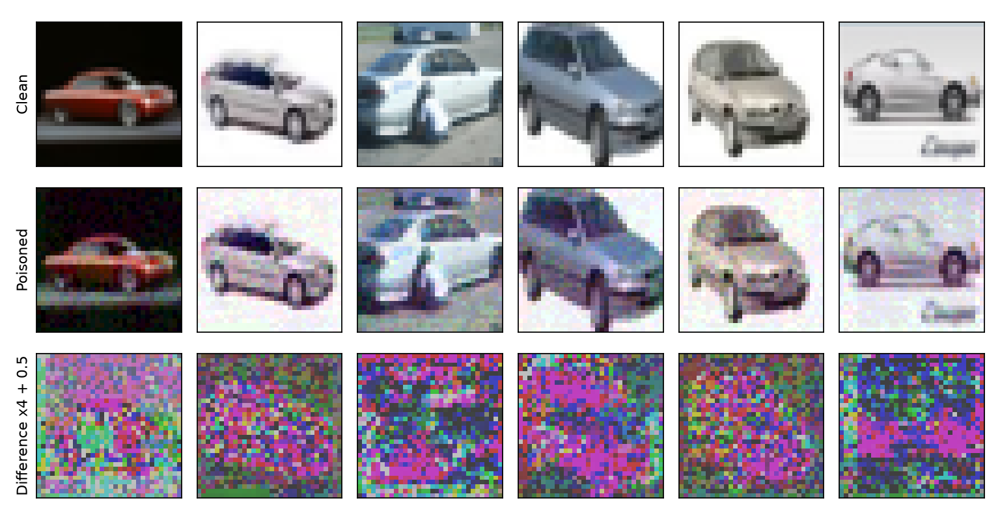
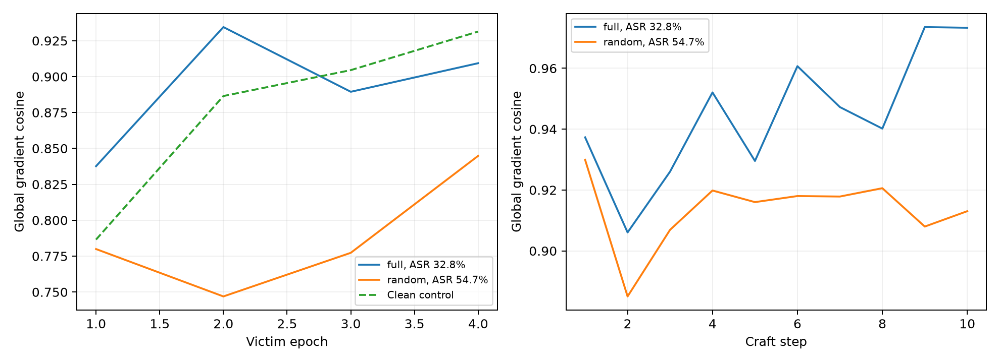

# Smoke-scale validation

These runs test the implementation, not the paper's quantitative claims. They use two classes, 512 total training images, 8 poisons, ResNet-9 with width 16, 3 surrogate epochs, 4 victim epochs, 10 craft steps, and one seed (17). These settings differ substantially from the full experiment, including a poison fraction of 1.56% instead of 1%.

| Arm | Clean accuracy | Patched ASR | Random-noise control ASR |
|---|---:|---:|---:|
| Fixed | 78.12% | 41.41% | 35.94% |
| Random | 80.47% | 54.69% | 35.94% |
| Random + retraining | 79.30% | 41.41% | 35.94% |
| Random + selection | 82.42% | 37.50% | 34.38% |
| Random + both | 76.95% | 32.81% | 34.38% |

The shared clean control reached 82.03% clean accuracy and 38.28% patched ASR. The full-attack arm did worse than this control and reduced clean accuracy by 5.08 percentage points. This run does **not** demonstrate an effective stealthy backdoor. More training and the full CIFAR-10 experiment are necessary before interpreting attack effectiveness.

Every trial passed the pixel-space bound, unchanged-label, target-only selection, exact poison-count, and exact trigger-absence assertions. The full arm's crafting cosine rose from 0.9373 to 0.9733, but alignment alone did not predict attack success in this undertrained setting. There is one trial per arm; standard errors and confidence intervals are unavailable.

ASR includes all 128 held-out source-class images, with uniformly random evaluation patch locations. Software: Python 3.12.15, PyTorch 2.11.0+cu128. Hardware: RTX 5070 Ti Laptop GPU, 12 GB. The full configuration's training settings are not represented by these numbers.

Run `.venv/Scripts/python.exe -m src.run_ablation --config configs/smoke.yaml` to reproduce these measurements. Raw trial checkpoints and configurations are local under `results/smoke/`.
